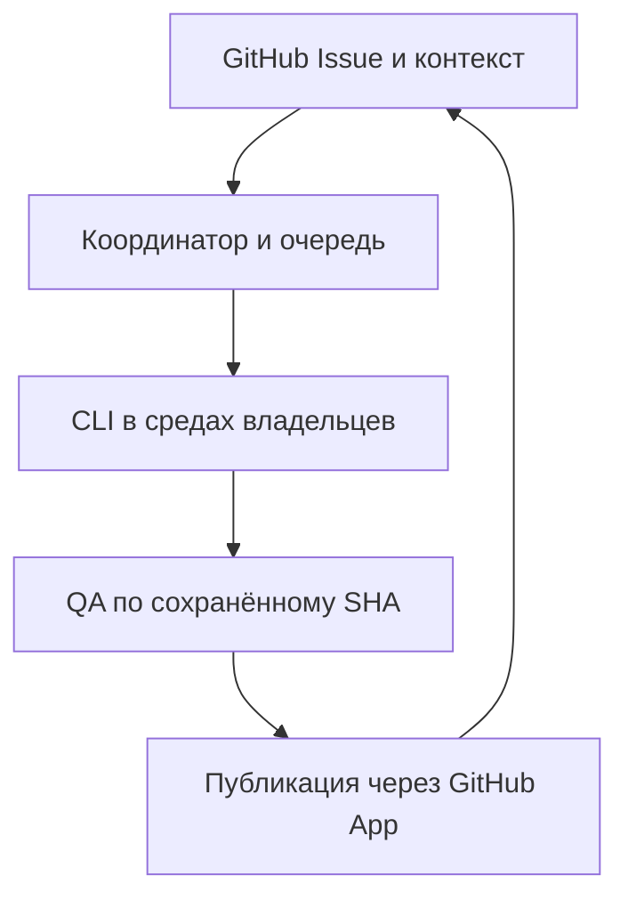

# Coordinator V3 — проект архитектуры

База аудита — `29fd98b6ccb4eaf6dd94b3a273e9aa6a7c64808a`. Связанные решения — [#19](https://github.com/cryptospacerus-maker/forY-cassa-/issues/19) и [#12, #15, #18, #10](https://github.com/cryptospacerus-maker/forY-cassa-/issues). Ревью #14/#16 сохраняют контракт V1/V2. PR #17 закрепил независимый вызов Судьи в Codex. Состояние ветки и решение о платной приёмке сверены с #15.

## Переиспользование

| Компонент | Действие для V3 |
| --- | --- |
| `agents/*.md`, профили и протокол | Брать с доверенного SHA. Судья вызывается отдельно. |
| `coordinator/context.py` и чтение требований | Сохранить проверку участника и ограничение объёма. Адаптировать извлечение требований и permission-check к GitHub App. |
| `coordinator_v2/engine.py`, `runtime.py`, `mcp.py` | Переиспользовать план, проверки путей и предложений, волны зависимостей, отдельную песочницу QA и тестовый MCP. Вызов модели сейчас синхронен и не получает ключ шага. V3 нужен отдельный оркестратор или согласованный адаптер этого контракта. |
| `coordinator/engine.py` и `coordinator/__main__.py` | Сохранить проверку SHA, Git-коммит, защиту публикации и сбор отчёта. Перенести привязанные к Actions claim/artifact операции на постоянное хранилище V3 только после согласования. |
| `coordinator_v2/journal.py` | Сохранить события и проверяемые доказательства. Состояния V3 записывать в отдельный журнал до согласования расширения схемы. |
| `coordinator/gateway.py` и `runner.Codex` | Оставить для V1/V2. API-бюджет и прокси не переносятся на подписку. |
| `coordinator/notify.py` | Уведомитель Actions остаётся для V1/V2. V3 формирует своё уведомление по завершению lease или по остановке воркера. |
| Worker Manager, Session Manager, очередь | Новые компоненты V3. Ветка прототипирует только контракт транспорта, состояние шага и однозначное возобновление. |

Несовместимость появится при смене схемы журнала V2, изменении имени старого workflow, ослаблении проверок публикации или повторном использовании V1/V2 ключей. V3 начинается отдельной командой и со своим пространством idempotency.

## Топология

Выбор для MVP — VPS хранит состояние и запускает координатор. Каждый владелец самостоятельно управляет своей CLI-средой. Worker соединяется с VPS исходящим HTTPS с отдельным отзывным ключом сервиса, ограниченным своим worker ID. Код и авторизация Codex остаются у владельца. На общем VPS с тремя Unix-пользователями проще мониторинг, но root и резервные копии получают общую зону доступа к чувствительным данным. Такой вариант отложен до отдельной оценки доверия и условий подписки.

| Роль | Worker | Полномочия |
| --- | --- | --- |
| Игорёк / analyst | Третий | Формирует структурированный план и критерии. |
| Тёма / developer | Толя | Предлагает изменения только в назначенных файлах. |
| Ксю / interface | Семён | Предлагает изменения интерфейса и назначенных файлов. |
| Андрюха / tester | Третий, отдельная роль и сессия | Получает требования и кандидат SHA, формирует вердикт. Команды QA выбирает сервер из проверенного профиля. |
| Судья | Отдельная команда | Оценивает опубликованный кандидат по запросу. |

## Контракты и состояние

- **GitHub Integration.** Для MVP polling комментариев с интервалом 30 секунд и перекрытием границы курсора, с обработкой страниц, rate-limit backoff и дедупликацией по ID события. Только точная команда V3 в открытом issue и только allowlist плюс актуальная проверка прав записи. Бот не инициирует запросы. Webhooks быстрее, требуют публичного приёмника, HMAC, защиты от повтора delivery ID и повторного чтения issue. Actions удобен для V1/V2, для V3 даёт дополнительный транспорт к постоянной очереди и не переносит локальные CLI-сессии. После пилота polling можно заменить вебхуком, сохранив проверку прав. [GitHub App](https://docs.github.com/en/apps/creating-github-apps/authenticating-with-a-github-app/authenticating-as-a-github-app-installation)
- **Task Queue.** SQLite с транзакционным claim, уникальным ключом репозиторий + issue + инициатор + request key, lease с heartbeat и номером поколения. Независимые задания идут параллельно по графу. На воркер один активный turn в пилоте. Просроченный уже выданный шаг получает `needs_review`. Сверка результата по job ID позволяет восстановить публикацию без повторного запуска. Истёкший ответ не принимается без сверки поколения. Невыданную работу можно вернуть в очередь.
- **CLI Adapter.** Передаёт ограниченный JSON по stdin и заданную сервером JSON Schema, принимает типизированные события и итог. Запуск и resume привязаны к каталогу роли. Рабочая реализация ограничивает размер stdout, ставит deadline, завершает группу процессов при отмене и не пишет сырой stderr в GitHub. Код тестового имитатора в этой ветке лишь описывает проверяемый интерфейс.
- **Worker Manager.** Владелец отдельно регистрирует worker и версию CLI. Состояния ready, busy, offline, auth_required, quota, needs_review. При квоте или ошибке авторизации очередь по этому ресурсу приостанавливается. Маршрут роли фиксирован. Оператор сверяет Usage или статус обновления с владельцем и затем возобновляет очередь.
- **Session Manager.** Привязка по (репозиторий, Issue, request, role, worker, digest контекста), локальное хранилище под правами владельца. Координатор хранит ссылку, но не историю сессии. Исправление продолжает ту же сессию в рамках той же версии требований. Изменённые требования останавливают шаг и требуют нового плана. Игорёк и Андрюха используют отдельные каталоги и явные ID, без `--last`.
- **Context & Memory.** GitHub хранит общие требования, AGENTS.md, PROJECT.md, профиль и статусы. Индивидуальная память — приватные JSON-записи у владельца с ролью, решением, ссылкой на источник, SHA и сроком пересмотра. Обновление предлагает агент, записывает валидатор после QA. Краткий оперативный контекст включает доверенные файлы со сверенного SHA, актуальный issue, разрешённые связанные задачи, критерии, выдержки предыдущих результатов и разрешённые пути. Лимиты объёма на пакет и каждое поле, удаление просроченных ссылок, запрет исполнения инструкций из Issue, комментариев и возвращённых файлов. Перед QA и публикацией сверяются digest требований и базовый SHA.
- **Публикация.** Координатор принимает только проверенный кандидат по точному SHA. GitHub App публикует ветку результата, один итог с упоминанием инициатора и ссылкой на действия. Длительная остановка после claim даёт отдельно дедуплицированное аварийное сообщение. Журнал публичной части хранит статус, роль, SHA и проверку, без содержимого личных сессий, токенов и секретов.

Рабочее исполнение следует ограничить одобренными каталогами, запретом произвольной оболочки у модели, выдачей только разрешённых проверок, защитой main и разделением задач, авторизации и QA. Для браузера и Docker проверяется отдельный runner без CLI-авторизаций. Детали эксплуатации описаны в [DEPLOYMENT.md](DEPLOYMENT.md).

## Офлайн-реализация

Команды, схема подключения и восстановление описаны в [README.md](README.md). Worker получает задания по исходящему HTTPS к прокси координатора. Ключ сопоставлен конкретному worker и алиасу, результат привязан к выданной аренде. Фактическая облачная топология, автоматический GitHub polling, автоматизированный выпуск токенов установки и отдельная постоянно работающая среда QA требуют эксплуатационного согласования. Импорт и публикация доступны как команды оператора. QA пока использует Docker runner V2 в среде, запускающей оркестратор. Локальная очередь и журнал транзакций позволяют продолжить работу через сохранённые результаты и QA по точному SHA.
