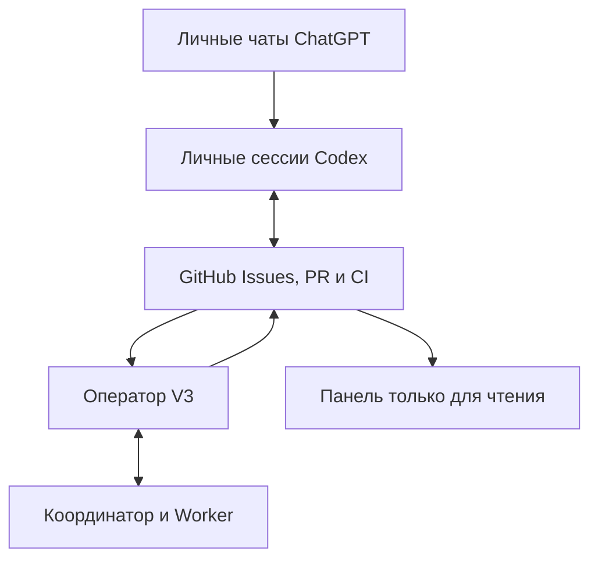

# Архитектура и модель состояния

## Участники и источники

| Источник | Что считается достоверным |
| --- | --- |
| GitHub Issue | Требование, версия кейса, критерии проверки, разрешённая область, ответственный за карточку, один владелец запуска, зависимости, принятые решения и ссылки на работу. |
| GitHub PR, commit, Actions, опубликованный отчёт | Результат определённого полного SHA, фактические проверки, вердикт, ссылка на V3 run. Результат другого SHA отображается как исторический. |
| V3 на хосте оператора | `status` для текущих Worker/ролей/шагов, `report <run>` для итогов, локальная очередь SQLite для leases и отмены. Закрытые данные и журналы остаются у оператора. |
| Личный чат ChatGPT | Черновики и обсуждение. Принятое решение записывает уполномоченный участник в Issue, либо Семён или Толя фиксирует общее требование в PROJECT.md по правилам проекта. |
| Личная сессия Codex | Интерпретация команды, проверка данных и работа существующими GitHub-инструментами от подтверждённой личности. Выполнение рабочих ролей остаётся в V3. |

Уточнение реального исполнителя: `analyst` Игорёк, `developer` Тёма, `interface` Ксю, `tester` Андрюха. Толя владеет Worker Тёмы, Семён — Ксю, третий владелец — средой Игорька и Андрюхи. `boss` или новый агент управления не вводятся. Судья `evaluator` запускается отдельной явной командой и не назначает работу.

## Карточка и связь с запуском

Обязательны «Требование», «Версия кейса», «Как проверить». Дополнительно фиксируются владелец запуска (GitHub login), ответственный за требования, область файлов или компонента, зависимости, ссылка на исходную задачу для исправления и согласованный профиль V3. Правило двух сверок действует при принятии поручения и перед публикацией или передачей. Код и критерии связываются с базовым SHA и полным SHA результата. Актуальную версию обозначают в тексте карточки, а общий переход между сессиями привязывают к ссылке на согласованное решение.

Для управления различаем запрос в GitHub (`prepared`, `accepted`), факт выполнения V3 (пока неизвестен, очередь, lease, остановка, завершение) и доставку (ожидает оператора, `posting`, ссылка на опубликованный итог). `prepared` подтверждает готовность карточки, `accepted` — проверенный V3 run ID. Этикетки GitHub и ручная сводка не доказывают выполняющийся процесс. Без доступа к хосту выводим последний опубликованный факт и его время, живой статус обозначаем «неизвестен». Служебную сводку оформляет оператор вне полей требований. Решения другого участника, которые должны попасть в V3, вносит ответственный в согласованное описание Issue. V3 отбирает комментарии инициатора, поэтому нельзя рассчитывать на включение произвольного комментария второго участника. Management-хеш, если используется, идентифицирует согласованный снимок Management Layer и хранится отдельно от `requirements_sha256` V3.

## Повторы и конфликты

1. **До VPS.** Оба участника могут предложить задачи и читать любые доступные данные. Создание канонической карточки, выбор версии и оформление передачи выполняет назначенный ответственный. Перед записью ищет открытые и недавно закрытые карточки по компоненту, ссылкам и ожидаемому результату. При совпадении возвращает ссылку на канонический Issue. При одинаковой цели с другой областью или версией явно запрашивает решение владельца. Параллельные черновики допустимы, каноническая карточка одна. Для будущего импорта записывается обычная заметка, без формальной команды запуска в ожидании допуска.
2. **Ручной V3.** Один назначенный оператор принимает решения о выдаче, даже если просьбы приходят из обеих сессий. Он сверяет открытость Issue, автора команды, версию, зависимости и активные пересечения областей. До `ingest` резервирует в своём журнале принятия логическую работу `repo + issue + approved revision + intent`, единственного инициатора, комментарий и request key. Для новой ревизии нужна подтверждённая остановка или завершение предыдущего запуска, а для новой независимой задачи — проверка пересечения областей. Повтор возвращает существующий run либо состояние сверки; другой инициатор использует ссылку на тот же результат. Ключ V3 включает репозиторий, Issue, автора и request key. Смена автора с тем же ключом может создать второй run, поэтому оператор никогда не импортирует вторую команду на ту же работу. Защита ручного пилота зависит от единственного маршрута и дисциплины оператора.
3. **Реализация Management MVP.** Один шлюз оператора сериализует решение по допуску. В закрытом журнале принятия (отдельное небольшое хранилище, без правок схемы V3) уникальны логическая работа и связь с канонической карточкой, задаётся резерв области до завершения или подтверждённой остановки. Для V3 импорт осуществляется штатным CLI из той же доверенной среды. Сначала атомарно резервируется операция и сохраняется идентификатор исходного комментария; затем выполняется импорт; далее записывается run ID и публикуется безопасная ссылка/статус перехода. До записи результата неопределённая операция остаётся зарезервированной. Повтор сверяет тот же комментарий и ключ V3, а при неизвестной публикации сверяет маркер и служебного автора. На пересечении областей (включая родительский путь) второй запуск ждёт решения владельца и явной зависимости. Согласованную передачу владельца записывают до новой выдачи. Для уже начатого запуска автора не переписывают.
4. **Когда правила нарушены или данные устарели.** Если GitHub/хост недоступен, версия изменилась либо настоящие права или состояние неизвестны, mutation останавливается, действующий V3 admission применяется как есть. Не повторять POST после неизвестного исхода, не переключать владельца и не переотправлять `needs_review`. Обход шлюза прямым операторским CLI остаётся возможностью уполномоченного оператора и исключается операционной политикой. Для №20 будущий watcher проходит тот же допуск. Сохранение курсора, доставка outbox и выпуск токенов принадлежат №20.

## Уведомления и панель

Оператор публикует итог штатным `publish <run>` с учётной записью издателя. V3 пишет один итог с маркером и @упоминанием инициатора. Второй участник видит тот же Issue, при желании подписывается на него. Канал доставки определяют настройки GitHub получателя. Ожидаем ссылку на комментарий и упоминание, доставку конкретного письма не считаем критерием. V3 хранит `posting` при неизвестном исходе, перед повторной записью проверяются существующий комментарий и служебный автор. Автопубликация относится к №20. Отмену, если она относится к открытому Issue и есть права, также можно донести штатным терминальным отчётом.

Для панели #6/#7 проектируется одна проекция только для чтения. Поля: issue URL, публичный run ID, роль, безопасное состояние, время наблюдения, источник, ссылка на SHA, QA и итог. Состояние помечается актуальным только в пределах срока свежести проверенного источника. Отсутствие наблюдения отображается явно. Панель читает опубликованный GitHub-контекст, а в будущем — очищенные снимки оператора через отдельный интерфейс чтения. Ни SQLite, ни POST-эндпоинты Worker, ни токены, lease ID, локальные thread ID и сырые логи в браузер не передаются. Интеграция панели не входит в пилот.
